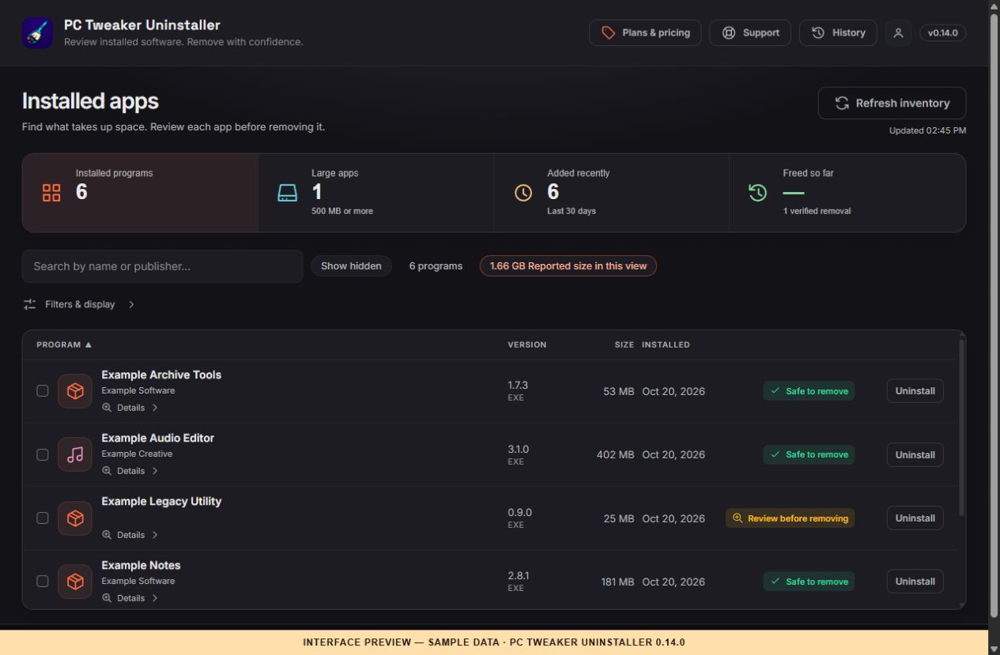
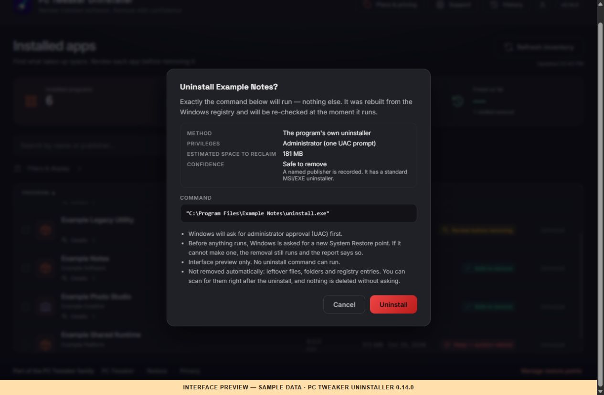
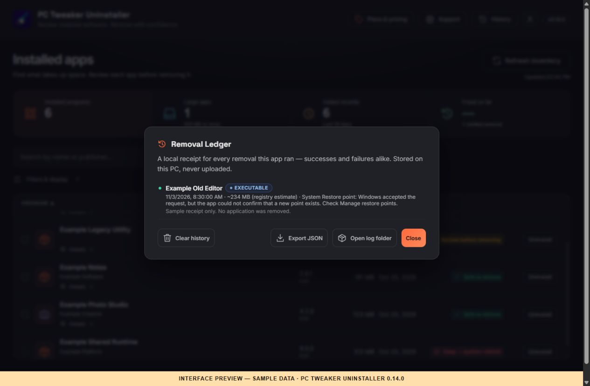
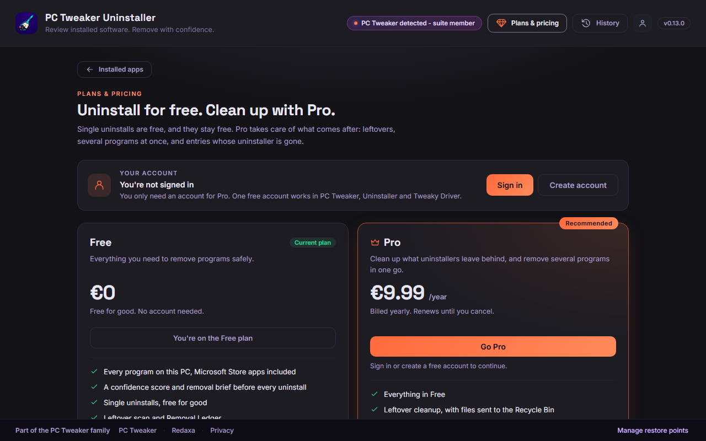

# PC Tweaker Uninstaller — Review Windows Removals Before They Run

For Windows users reviewing installed software and its removal risk. Inspect the registered uninstall command and permissions, then keep a local removal receipt; review leftovers separately.

[Product](https://pctweaker.app/uninstaller/) · [Official downloads](https://github.com/AurelioAvila/pc-tweaker-uninstaller/releases/latest) · [Chocolatey](https://community.chocolatey.org/packages/pc-tweaker-uninstaller) · [Verify the publisher signature](https://github.com/AurelioAvila/.github/blob/master/CODE_SIGNING.md)

<p align="center">
  
</p>

<p align="center">
  <strong>Removal Intelligence for Windows.</strong><br>
  Remove software with clarity, not guesswork — part of the PC Tweaker suite.
</p>

<p align="center">
  <a href="https://pctweaker.app/uninstaller/"></a>
  <a href="https://github.com/AurelioAvila/pc-tweaker-uninstaller/blob/master/LICENSE"></a>
  <a href="https://github.com/AurelioAvila"></a>
  <a href="https://github.com/AurelioAvila/pc-tweaker-uninstaller/releases/latest"></a>
</p>

<p align="center"></p>

*Current 0.14.0 frontend, captured November 3, 2026. All program names, sizes and receipts are fictional sample data. No software was removed.* [Capture details and hashes](docs/SCREENSHOTS.md).

## Before you uninstall, see the plan

Inspect the exact command, requested permissions and recovery limits before
confirming a removal. Confidence labels explain the available evidence; they do
not guarantee that an application or its data can be recovered.



## Afterward, read what actually happened

The local Removal Ledger separates reported size from verified recovered space
and records the restore-point outcome. This fictional example explicitly shows
an unverified restore point and no measured reclaimed space.



## Download

**[Official product page](https://pctweaker.app/uninstaller/)** — release status
and product information. Uninstaller shares a suite account with PC Tweaker,
with product-specific entitlements. A PC Tweaker license token cannot be used as
an Uninstaller license token. PC Tweaker Lifetime owners also have a
[documented 12-month Uninstaller Pro benefit](https://github.com/AurelioAvila/pc-tweaker-app#free-and-pro),
activated on first sign-in to Uninstaller with the same account. This is a
separate, time-limited entitlement, not a perpetual Uninstaller license.

**[Download latest signed version](../../releases/latest)** for Windows 10/11 x64.
The [0.15.0 setup EXE](../../releases/tag/v0.15.0) was checked on November 5, 2026,
after downloading it again from the published release: its Authenticode signature
identifies **Aurelio Avila** and includes a trusted DigiCert timestamp.
Its SHA-256 is `9196d02409587fce4c0eda83190f166fd122d11c5279fb4ad311575dc63cfff1`.
This check applies to that specific setup EXE, not every asset or future build.
Historical version 0.8.2 remains unsigned; use current official downloads.

**WinGet status (November 5, 2026):** the latest stable release is 0.15.0. The [new-package submission](https://github.com/microsoft/winget-pkgs/pull/434135),
now carrying 0.15.0 and updated to manifest schema 1.28.0 on November 3, is awaiting moderator review. Passing automated checks is not catalog approval.
Use the GitHub release or Chocolatey while WinGet review is pending.

Signing identifies the publisher and protects file integrity; neither code signing
nor WinGet guarantees the absence of SmartScreen warnings.

See the [signing inventory and verification guide](https://github.com/AurelioAvila/.github/blob/master/CODE_SIGNING.md).
Use official downloads and investigate security warnings before proceeding.

## Install with Chocolatey

Version **0.14.0** was approved in the [Chocolatey Community Repository](https://community.chocolatey.org/packages/pc-tweaker-uninstaller/0.14.0) on November 4, 2026. The package downloads the official publisher-signed setup and checks its fixed SHA-256.

Inspect the package details, then install if appropriate:

```powershell
choco info pc-tweaker-uninstaller
choco install pc-tweaker-uninstaller
```

This installs Uninstaller; it does not request the removal of any other application. Repository package approval is separate from the pending WinGet submission above.

## What it does

Uninstall Windows programs cleanly, with a safety net. Every removal is explained before it runs and recorded after it finishes.

| | |
| --- | --- |
| **Removal Confidence Score** | Every program is rated Safe, Review or Keep, with the reasons spelled out. System components and runtimes other software depends on are flagged before you touch them. |
| **Removal Brief** | Before anything runs you see the exact command, the method (Windows Installer or the program's own uninstaller), the permissions it will ask for and the reported size. |
| **Related programs** | Programs installed inside another program's folder are named before you remove the parent, so a game library or plugin host does not take other software with it by surprise. |
| **Restore-point attempt** | Before elevated removals, the app asks Windows for a restore point and records what Windows actually did: a new point, the existing point it reused (Windows makes at most one a day), or why none was made. The confirmation says beforehand which to expect. |
| **Leftover scan** | After the uninstall, the program's remaining folders, shortcuts and registry keys are listed, each with the reason it is listed. Only the install folder Windows recorded for the program is pre-selected; items found by name only are marked and never pre-selected. Protected system and personal folders are never offered. |
| **Programs removed earlier** | The app notices programs that disappeared from the installed list between launches, whoever removed them, and keeps the last 50. Any of them, or a name and folder you type, can be scanned for leftovers later. |
| **Removal Ledger** | A local receipt of what was removed, how, with what result and how much space was actually freed. Exportable, and it never leaves your PC. |
| **Store apps too** | Classic desktop software and Microsoft Store apps in one list, with search, filters, sorting and CSV export. |

6 languages (English, Italian, French, Spanish, German and Portuguese), 8 themes, and one suite account shared with PC Tweaker and Tweaky Driver, with password reset, email verification and password and email changes inside the app.

### Free and Pro

| Free | Pro |
| --- | --- |
| Unlimited single uninstalls, desktop and Store apps | Everything in Free |
| Confidence Score and Removal Brief for every program | **Registry and startup cleanup**: remove the leftover registry keys and startup entries the scan finds, each saved as a .reg file first |
| Restore-point attempt before elevated removals, with the outcome recorded | **Batch removal**: queue several programs and let them run in a safe order |
| Cleanup of leftover files and folders, sent to the Recycle Bin | |
| Leftover scan, programs removed earlier, and the Removal Ledger | **Broken entries**: remove programs whose own uninstaller is gone |

**Plans & pricing** in the app's top bar compares both plans, shows your account
and plan, and opens Stripe's billing portal to manage a subscription. Current
offers appear there only while the server reports them as running. See also the
[official product page](https://pctweaker.app/uninstaller/).

<p align="center"></p>

## Architecture

- **Desktop app**: Tauri 2 (Rust core) + React 19 + TypeScript (strict).
- **Backend**: the shared PC Tweaker ecosystem backend (accounts, signed
  licenses, Stripe). This repo contains no server code and no secrets.
- **License model**: the backend signs `{userId, isPro, plan, product,
  issuedAt}` with an Ed25519 key; this client verifies the exact signed
  bytes with the embedded public key and additionally requires
  `product == "uninstaller"` — a valid PC Tweaker license does not unlock
  this app (see `src-tauri/src/license.rs`).
- **Safety model**: every reversible change is snapshotted before it is
  applied (`src-tauri/src/rollback.rs`, atomic writes + locking, ported
  with its tests from PC Tweaker). Privileged actions run one at a time
  through an explicit UAC consent (`src-tauri/src/elevation.rs`).

## Development

```
npm install
npm run tauri dev
```

`npm run tauri:dev:profile` runs an isolated development profile: its own app
identifier (so its own sign-in, license cache and WebView storage), port 1431,
and API calls proxied through the dev server, since the backend only accepts
the installed app's origin. The Removal Ledger and diagnostic log still live in
the regular data folder, so do not uninstall or clear history from a dev build
unless that is the point of the test.

Checks (the same list gates CI, in `scripts/check.mjs`):

```
npm run check         # every CI check: types, tests, lint, prettier, build,
                      # Tauri JS/Rust version pairing, cargo fmt, clippy, cargo test
```

Release maintainers: follow the [local signing and verification procedure](RELEASING.md).
Distribution must stop if publisher signing or timestamp verification fails.

## Legal

The source is published for review and transparency only — see
[LICENSE](LICENSE): no rights are granted to use, copy, modify, or
redistribute it. Use of the compiled application is governed by
[TERMS.md](TERMS.md); how data is handled is documented in
[PRIVACY.md](PRIVACY.md).

## Security notes

- No secrets in this repo; the signing private key exists only on the
  backend host. The embedded key here is the public (verify-only) half.
- Release builds never enable DevTools (see `src-tauri/Cargo.toml`).
- CSP allows network access exclusively to the ecosystem backend.

## Support

For support or billing questions, email [uninstaller@pctweaker.app](mailto:uninstaller@pctweaker.app). Include the app version and steps to reproduce the problem. Never send passwords, access tokens, private keys or payment card details, and remove sensitive information from screenshots and logs.

## More tools by Aurelio Avila

- [PC Tweaker](https://pctweaker.app/): Windows tuning for performance, gaming and privacy, with hardware monitoring and restore tools for supported settings.
- [Tweaky Driver](https://pctweaker.app/tweaky-driver/): Windows driver inventory and update review, showing detected devices, installed versions and available driver offers.
- [Redaxa](https://redaxa.getcertsprint.com/): Sensitive-data checks and redaction for AI prompts, plus local repository secret reviews on Windows.
- [Redexa Social](https://redexa.getcertsprint.com/): Private YouTube analytics for Windows, kept in a database on your PC.
- [Glarion](https://glarion.app/): Verified website security checks and white-label reports for digital agencies.
- [Frame Witness](https://framewitness.pages.dev/): Windows photo and video recovery with source offsets, SHA-256 hashes and dated findings.
